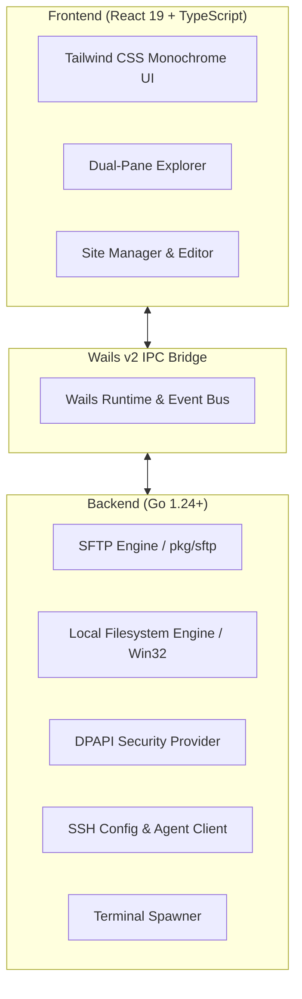

<div align="center">

# ⚡ fast-ftp

**A high-performance, secure, and modern desktop SFTP client with an uncompromising monochrome design for Windows.**

Built with [Go](https://go.dev/), [Wails v2](https://wails.io/), [React 19](https://react.dev/), and [Tailwind CSS](https://tailwindcss.com/).

[](https://go.dev/)
[](https://wails.io/)
[](https://react.dev/)
[](https://www.typescriptlang.org/)
[](https://tailwindcss.com/)
[](https://microsoft.com/windows)
[](LICENSE)

</div>

---

## 📖 Overview

**fast-ftp** is an ultra-fast desktop SFTP client designed for developer speed, security, and aesthetics. Built with native Go system routines and a frameless, high-contrast monochrome interface, fast-ftp eliminates the visual clutter of legacy FTP clients while providing instant startup and minimal RAM consumption.

With seamless `~/.ssh/config` discovery, native Windows DPAPI credential encryption, and instant terminal launching, fast-ftp makes remote server file operations effortless.

---

## ✨ Features

- ⚡ **Dual-Pane File Manager**: Side-by-side local disk and remote SFTP browsing with segmented breadcrumbs, quick filtering, and keyboard navigation.
- 🖤 **Professional Monochrome Design**: High-contrast, distraction-free neutral dark theme crafted for developers, with precision tabular numbers and clean typography.
- 🔒 **Hardware-Backed Credential Security**: Saved connection passwords and key passphrases are encrypted using native **Windows DPAPI** (`CryptProtectData`), ensuring secrets cannot be extracted across machines.
- 📑 **Automatic SSH Config Discovery**: Instantly scans and parses your existing `~/.ssh/config` file. Connect to your hosts without manual re-entry.
- 🔑 **SSH Agent & Key Management**: First-class integration with Windows OpenSSH Agent named pipe (`\\.\pipe\openssh-ssh-agent`) and automatic discovery of keys in `~/.ssh`.
- 💻 **Integrated Terminal Spawner**: Launch straight into Windows Terminal or PowerShell SSH session matching your current remote directory with a single click.
- 📝 **Built-in Remote File Editor**: View and edit remote code and configuration files directly inside the application with auto-upload on save.
- 📊 **Real-time Transfer Queue**: Monitor upload and download speeds, bytes transferred, elapsed time, and error states with a dedicated drawer.

---

## 🛠️ Architecture & Tech Stack



| Layer | Technologies |
| :--- | :--- |
| **Backend Core** | Go 1.24, `golang.org/x/crypto/ssh`, `pkg/sftp`, Windows Win32 API |
| **Application Runtime**| [Wails v2](https://wails.io/) (webview2 desktop wrapper) |
| **Frontend Framework** | [React 19](https://react.dev/), [TypeScript 5](https://www.typescriptlang.org/) |
| **Bundler & Tooling** | [Vite 7](https://vitejs.dev/), [Bun](https://bun.sh/) |
| **Styling & Icons** | [Tailwind CSS v4](https://tailwindcss.com/), [Lucide React](https://lucide.dev/) |

---

## 🚀 Getting Started

### Prerequisites

Ensure you have the following installed on your system:
- **[Go 1.24+](https://go.dev/dl/)**
- **[Bun](https://bun.sh/)** (or Node.js 18+)
- **[Wails CLI v2.17+](https://wails.io/docs/gettingstarted/installation)**:
  ```bash
  go install github.com/wailsapp/wails/v2/cmd/wails@latest
  ```

### Development Mode

Run the live-reloading development server:

```bash
# Clone the repository
git clone https://github.com/fizray/fast-ftp.git
cd fast-ftp

# Start development mode (with Vite hot-reload & Go live compilation)
wails dev
```

### Production Build

To compile a single production executable or installer:

```bash
# Using Wails directly
wails build -clean

# Or build with NSIS Windows installer
wails build -clean -nsis
```
The compiled binary will be placed inside `build/bin/fast-ftp.exe`.

---

## 📂 Project Structure

```
fast-ftp/
├── .github/                  # GitHub Actions CI/CD & Issue Templates
│   ├── ISSUE_TEMPLATE/       # Bug report & Feature request templates
│   ├── workflows/            # Continuous Integration & Release pipelines
│   └── pull_request_template.md
├── backend/                  # Pure Go backend packages
│   ├── localfs/              # Fast Win32 local disk & drive manager
│   ├── models/               # Shared domain structs & IPC payloads
│   ├── security/             # Windows DPAPI encryption routines
│   ├── sftp/                 # SFTP connection, transfer & file operations
│   ├── sshutil/              # SSH config parser & OpenSSH agent pipe
│   ├── store/                # Saved profile storage & credential vault
│   └── terminal/             # Windows Terminal & PowerShell launcher
├── build/                    # Wails build configurations, icons & NSIS scripts
│   ├── bin/                  # Build output destination
│   └── windows/              # Windows manifest, icons, and installer scripts
├── frontend/                 # React 19 + TypeScript single-page application
│   ├── src/
│   │   ├── assets/           # Fonts and static media
│   │   ├── components/       # UI components (Panes, Modals, Drawer, Header)
│   │   ├── types/            # TypeScript interfaces
│   │   ├── utils/            # Formatting & helper utilities
│   │   ├── App.tsx           # Main application state & layout
│   │   └── style.css         # Global Tailwind styles
│   └── wailsjs/              # Auto-generated Wails Go-to-TypeScript bindings
├── scripts/                  # Development & build helper scripts
│   └── build.ps1             # PowerShell task runner
├── app.go                    # Wails application binding methods
├── main.go                   # Desktop window bootstrap & startup config
├── Makefile                  # Unix/Git Bash task runner
├── wails.json                # Wails project manifest
└── README.md
```

---

## 🧰 Developer Automation

Unified task runners for both Windows PowerShell and GNU Make:

| Task | PowerShell (`scripts/build.ps1`) | Make (`Makefile`) | Description |
| :--- | :--- | :--- | :--- |
| **Validate All** | `.\scripts\build.ps1 -Task check` | `make check` | Runs `go vet`, unit tests, and TypeScript check |
| **Run Tests** | `.\scripts\build.ps1 -Task test` | `make test` | Executes backend Go test suite |
| **Typecheck** | `.\scripts\build.ps1 -Task typecheck` | `make typecheck` | Validates frontend TypeScript types |
| **Build** | `.\scripts\build.ps1 -Task build` | `make build` | Compiles clean production binary |
| **Clean** | `.\scripts\build.ps1 -Task clean` | `make clean` | Cleans `build/bin/` and `frontend/dist/` |

---

## 🔒 Security

All credentials stored within fast-ftp are encrypted at rest using the **Windows Data Protection API (DPAPI)**. Your passwords never touch disk in plain text and cannot be transferred to or read from another user account or machine.

For more information, please see [SECURITY.md](SECURITY.md).

---

## 🤝 Contributing

Contributions are welcome! Please review our [CONTRIBUTING.md](CONTRIBUTING.md) for workflow guidelines and coding standards before submitting a pull request.

---

## 📜 License

Distributed under the **MIT License**. See [LICENSE](LICENSE) for more information.
